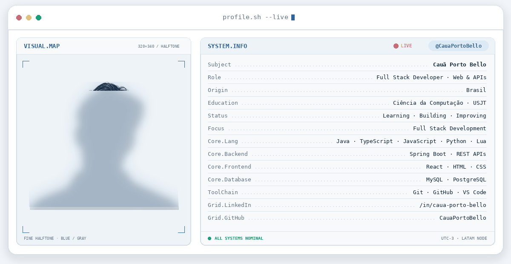

<!-- CARD PRINCIPAL: GIFs locais com suporte aos temas claro e escuro do GitHub. -->
<picture>
  <source media="(prefers-color-scheme: dark)" srcset="assets/profile-card-dark.gif">
  <source media="(prefers-color-scheme: light)" srcset="assets/profile-card-light.gif">
  
</picture>

 

&nbsp;&nbsp;

&nbsp;&nbsp;

  

 

---

## Sobre mim

Sou **Cauã Porto Bello**, estudante de **Ciência da Computação na Universidade São Judas Tadeu** e desenvolvedor de software. Meu primeiro contato com programação aconteceu cedo, criando scripts e sistemas para servidores multiplayer com **Lua e MySQL**. Essa experiência despertou meu interesse por lógica, estrutura de sistemas e resolução de problemas.

Atualmente, meu foco é o **desenvolvimento Full Stack**: criar aplicações de ponta a ponta, integrando interfaces web, regras de negócio, APIs e bancos de dados. Exploro tecnologias como **React, TypeScript e JavaScript** no front-end, além de **Java, Spring Boot e APIs REST** no back-end.

Na universidade, atuei como **líder de sala**, experiência que fortaleceu minha comunicação, organização e colaboração em equipe. Também possuo **inglês avançado**, desenvolvido ao longo de cinco anos de estudos na Cidadão Pró Mundo.

## Foco de desenvolvimento

- **Full Stack:** desenvolvimento de aplicações web de ponta a ponta, conectando interface, lógica e dados.
- **Front-end:** React, TypeScript, JavaScript, HTML e CSS.
- **Back-end e dados:** Java, Spring Boot, APIs REST, MySQL e PostgreSQL.

## Tecnologias

  

## Projeto em destaque

### [Planejador Financeiro Pessoal](https://github.com/CauaPortoBello/planejador-financeiro)

Aplicação web gratuita que transforma informações financeiras em um diagnóstico e um plano de ação. O projeto foi desenvolvido com **React e TypeScript**, com foco em privacidade, clareza e previsibilidade dos cálculos.

- Motor financeiro determinístico, separado da interface.
- Processamento realizado localmente no navegador, sem cadastro ou backend.
- **137 testes automatizados aprovados.**
- Publicação contínua pelo GitHub Pages.

  
  

## Estatísticas do GitHub

  <picture>
    <source media="(prefers-color-scheme: dark)" srcset="https://github-readme-stats.vercel.app/api?username=CauaPortoBello&show_icons=true&theme=github_dark&hide_border=true&include_all_commits=true&locale=pt-br">
    <source media="(prefers-color-scheme: light)" srcset="https://github-readme-stats.vercel.app/api?username=CauaPortoBello&show_icons=true&theme=default&hide_border=true&include_all_commits=true&locale=pt-br">
    
  </picture>
  <picture>
    <source media="(prefers-color-scheme: dark)" srcset="https://github-readme-stats.vercel.app/api/top-langs/?username=CauaPortoBello&layout=compact&theme=github_dark&hide_border=true&langs_count=8&locale=pt-br">
    <source media="(prefers-color-scheme: light)" srcset="https://github-readme-stats.vercel.app/api/top-langs/?username=CauaPortoBello&layout=compact&theme=default&hide_border=true&langs_count=8&locale=pt-br">
    
  </picture>

---

  Aprender continuamente. Construir com propósito. Evoluir a cada projeto.

